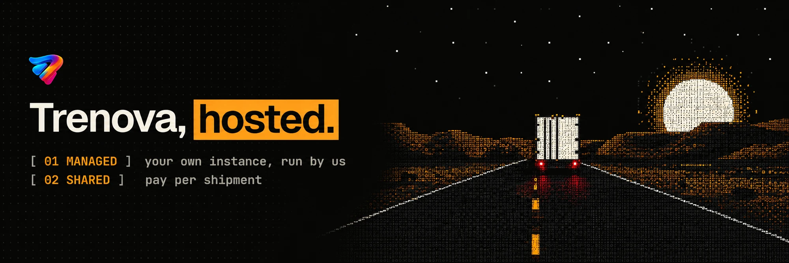
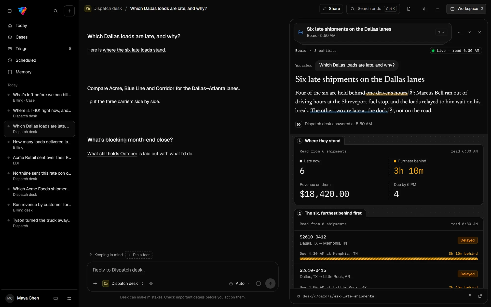
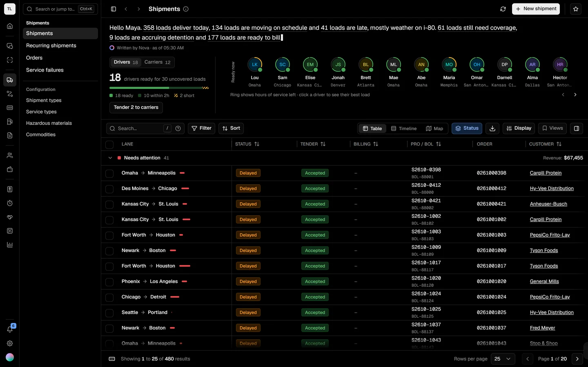
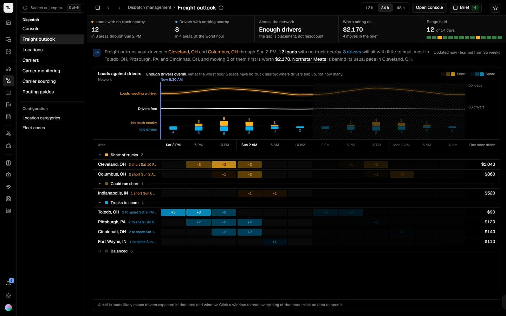

<div align="center">
  <a href="https://trenova.app/pricing/"></a>
  <h1>Trenova: Transportation Management System for Trucking Carriers</h1>
  <p>
    The carrier TMS that runs itself: shipments, dispatch, billing, accounting and compliance on one record,<br>
    with AI desks that take on the routine work. Hosted for you, or self-hosted for free.
  </p>
  <p>
    <a href="https://trenova.app">Website</a> ·
    <a href="https://trenova.app/features/">Features</a> ·
    <a href="https://trenova.app/pricing/">Pricing</a> ·
    <a href="https://trenova.app/self-hosted/">Self-hosting</a> ·
    <a href="https://github.com/emoss08/trenova/discussions">Discussions</a> ·
    <a href="https://discord.gg/XDBqyvrryq">Discord</a>
  </p>
  <p>
    <a href="https://github.com/emoss08/trenova/releases"></a>
    <a href="./LICENSE"></a>
  </p>
</div>

> [!IMPORTANT]
> Trenova is in closed beta. Self-hosted releases are pre-release software under active development. Follow [releases](https://github.com/emoss08/trenova/releases) or join the [waitlist](https://trenova.app/waitlist/) for updates.

Trenova is a transportation management system for small and mid-sized over-the-road carriers in
the United States. It covers the full order-to-cash cycle at a flat price, with no per-seat fees,
for carriers priced out of enterprise platforms. The source is public under the Fair Source
[Functional Source License](https://fsl.software/), so you can read it, audit it and run it
yourself.

<p align="center">
  
</p>
<p align="center">
  
  
</p>

## Features

Every carrier gets the core: **shipments, dispatch, billing, documents and reports**, all on one
shipment record, from the first tender to the paid invoice. Add-ons switch on only where you need
them.

**Revenue**

- **Accounting and cash**: a general ledger, receivables, close and cash application on the shipment record.
- **Rating and revenue recovery**: versioned rate formulas, fuel surcharge, accessorials, and detention billed with the timestamps attached.
- **Fuel and IFTA**: fuel purchases, card feeds, and IFTA returns built from your own miles.

**Operations**

- **Dispatch intelligence**: the Freight Outlook shows where trucks will run short, and the optimizer suggests who should take each load.
- **Visibility and tracking**: live position, hours of service and ETAs on every load, shared with your customers.
- **Carrier and brokerage**: source, tender, track and settle brokered freight.

**People and paperwork**

- **Driver pay**: settlements from the shipment record, and a portal for the drivers themselves.
- **Safety and compliance**: driver qualification, credentials, testing and FMCSA safety records.
- **Document intelligence**: BOLs, PODs and rate confirmations read straight into shipment data.
- **HR suite**: time off, schedules, benefits and reviews.

**Platform**

- **Trenova AI**: the Desk, triage, the watchtower, and agents that handle coverage, detention, intake, billing and compliance, and earn the right to act one tool at a time. Runs on the model you choose, hosted or on your own GPUs.
- **EDI and integrations**: self-serve EDI 204, 210, 214, 990 and 997 with your trading partners, telematics (Samsara), PC*MILER and AS2.
- **Security and identity**: single sign-on, directory sync, role-based permissions and a full audit trail.

The full catalog is at [trenova.app/features](https://trenova.app/features/), and the
[product guide](./docs/product-guide/README.md) explains every page.

## Ways to run Trenova

| | What you get |
| --- | --- |
| **[Managed Trenova](https://trenova.app/pricing/)** | Your own Trenova instance, hosted, upgraded and backed up for you. Flat plans, add-ons when you need them. In closed beta. |
| **Shared Trenova** | A workspace on Trenova's shared servers: a small monthly base plus a charge per shipment. Coming soon. |
| **[Self-hosted](./docs/self-hosting/README.md)** | Free. The released images on your own Linux host with Docker Compose, with automatic HTTPS. |

## Quick start

To run Trenova from source, you need Go 1.27.4, Bun 1.4.5, Docker and
[Task](https://taskfile.dev/).

```bash
git clone https://github.com/emoss08/trenova.git && cd trenova
cp .env.example .env
docker compose -f dev/compose.yml up -d   # PostgreSQL, Redis, MinIO, Meilisearch and the rest
task tms:run                              # the TMS API
cd client && bun install && bun run dev   # the web client
```

The [local development guide](./docs/development.md) covers low-resource machines, malware
scanning, the tech stack and the repository layout.

## Documentation

- [Local development](./docs/development.md): run Trenova from source.
- [Self-hosting](./docs/self-hosting/README.md): requirements, DNS and TLS, first sign-in, upgrades, backups and troubleshooting.
- [Product guide](./docs/product-guide/README.md): what each page is for and how to use it.
- [Engineering guides](./docs/engineering/README.md): architecture and the patterns for each layer.

## Contributing

Trenova is Fair Source for transparency and community review, but external code contributions
are not accepted at this time. Bug reports, feature ideas and deployment findings are welcome in
[Issues](https://github.com/emoss08/trenova/issues),
[Discussions](https://github.com/emoss08/trenova/discussions) or on
[Discord](https://discord.gg/XDBqyvrryq). Report security vulnerabilities privately as described
in [SECURITY.md](./SECURITY.md). See [CONTRIBUTING.md](./CONTRIBUTING.md) for details.

## License

Trenova is licensed under the [Functional Source License, Version 1.1, Apache 2.0 Future License](./LICENSE) (FSL-1.1-ALv2). You may use, self-host, and modify Trenova, including in commercial environments. You may not offer it as a hosted service or use it to build a competing product. Each release converts to the Apache 2.0 license two years after publication.

The directory `services/tms/internal/cloud`, which runs Trenova's own hosted service, is not under the FSL: it has its own license, the [Trenova Commercial License](./services/tms/internal/cloud/LICENSE), which lets you read and test it but not run it in production or offer it as a service without an agreement.
